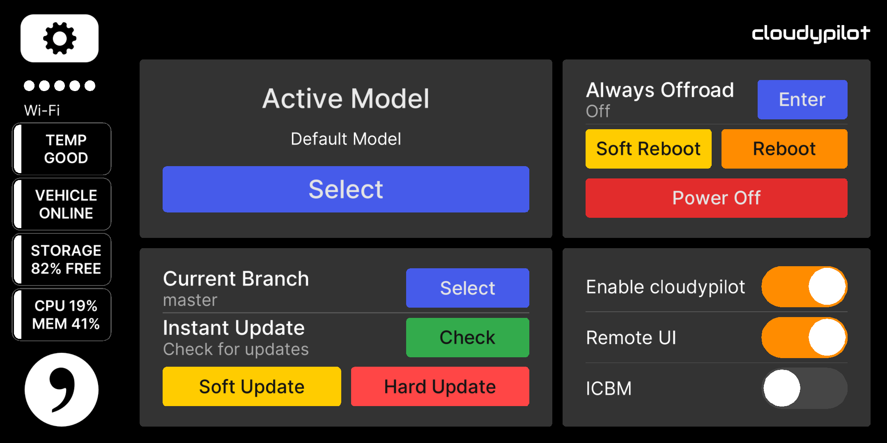
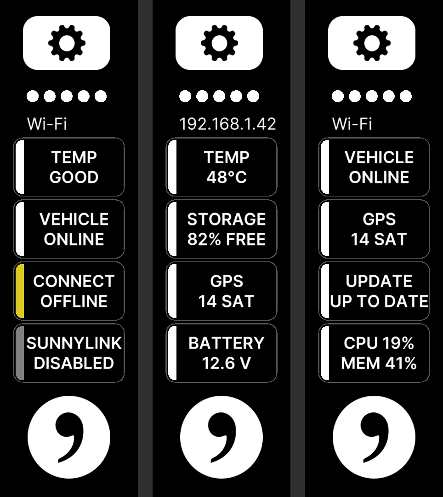
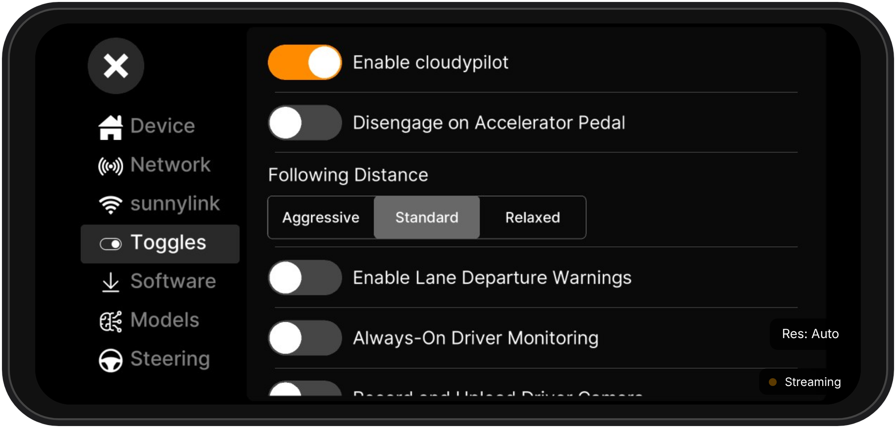

# cloudypilot

cloudypilot is a personal fork of [sunnypilot](https://github.com/sunnypilot/sunnypilot), itself a fork of [openpilot](https://github.com/commaai/openpilot).
> **This is a potentially unsafe fork.** cloudypilot is not affiliated with, endorsed by, or supported by sunnypilot, comma.ai, or the openpilot developers.

*The home screen: active model, instant updates, device power controls, and quick toggles.*

## Safety first

cloudypilot includes changes to safety-critical code, including steering-angle limits. While this does not explicitly break any of comma's rules, tread carefully if using this fork and uploading to comma connect. Driver-monitoring and longitudinal-engagement safety code have not been intentionally weakened or removed.

This software operates a motor vehicle. Use it only if you understand the risks, follow all local laws, and can maintain constant attention and control. **Install and use cloudypilot entirely at your own risk.** It is alpha-quality research software, not a product, and comes with no warranty.

## Installation

cloudypilot's master branch can be installed using the following URL: `installer.hauckelabs.dev`

## Features and changes

### Controls

- Override the learned steering-ratio value with a custom fixed value.
- Configure the low-voltage shutdown threshold.
- Use imperial units (feet) in the on-road developer UI.
- Toggle the Steering Arc background fade effect independently.
- Select the stable.konik.ai API instead of comma Connect.
- Configure a 0–10 second post-blinker delay before lateral control re-engages when **Pause Lateral Control with Blinker** is enabled. This feature has since been merged upstream into sunnypilot.

### Other changes

- Add a **Soft Reboot** button to the Device panel and support `sudo systemctl restart comma` without triggering the hardware-reset prompt. Standard hardware reboot behavior is preserved.
- Reset configurable options to their defaults by tapping the current value.
- Rework the home screen into cards for the active model, software updates, device power controls, and quick toggles (more info below).
- Customize and reorder the sidebar, and choose the home screen quick toggles, from the new **Personalize** settings panel (more info below).
- Stream and interact with the device remotely with the built-in Remote UI streamer (more info below).

## Home screen

The home screen is split into four cards:

- **Active Model** shows the current driving model, with a shortcut to the Models panel.
- **Software** shows the current branch, with a shortcut to the Software panel, and an **Instant Update** row. **Check** fetches the remote and enables **Soft Update** if the branch can fast-forward, or **Hard Update** if it was force-pushed. **Soft Update** pulls the latest changes and soft reboots; **Hard Update** hard-resets to the remote branch before rebooting.
- **Device** holds Always Offroad Mode plus **Soft Reboot**, **Reboot**, and **Power Off** buttons.
- **Quick Toggles** turns up to three settings on or off without opening Settings. It shows Enable cloudypilot, Remote UI, and ICBM (Intelligent Cruise Button Management, when the car supports it) by default, and which toggles appear can be changed in the **Personalize** panel (more info below).

Until the device is paired, the pairing prompt takes the place of the Device and Quick Toggles cards.

## Personalize the sidebar and quick toggles

The **Personalize** panel in Settings controls which status tiles appear in the sidebar. The network indicator can be shown or hidden, and can show the device's IP address in place of "Wi-Fi" when connected to Wi-Fi. Up to four of the following tiles can be enabled at once:

- **Temperature**, shown as GOOD/HIGH or, optionally, in degrees
- **Vehicle** (panda connection)
- **Connect** (comma connect/konik stable status)
- **sunnylink**
- **Storage** (free space)
- **GPS** (fix and satellite count)
- **Car Battery** (voltage)
- **Remote UI** (number of connected clients)
- **Update** (software update status, held at its last offroad value while driving)
- **System Load** (CPU and memory usage)

Once four tiles are on, the rest are disabled until one is turned off.

*Pick any four tiles and arrange them however you like.*

To reorder the tiles, hold one for half a second while parked until it lifts, then drag it to a new spot. The order is saved, and hidden tiles keep their place for when they're turned back on.

### Quick Toggles

The **Personalize** panel also controls which toggles appear in the home screen's Quick Toggles card. Up to three of the following can be shown at once:

- **Enable cloudypilot**
- **Remote UI**
- **ICBM** (Intelligent Cruise Button Management)
- **MADS** (Modular Assistive Driving System)
- **SCC Vision** and **SCC Map** (Smart Cruise Control)
- **Disengage on Gas**
- **Lane Departure** (warnings)
- **Always-On DM** (driver monitoring)
- **Driver Camera** (record and upload)
- **Record Audio**
- **Metric Units**

Once three are on, the rest are disabled until one is turned off. Toggles that don't apply to the car, like ICBM when cloudypilot controls longitudinal or SCC without cloudypilot longitudinal or ICBM, show as unavailable.

## Remote UI Stream

cloudypilot incorporates the [raylib implementation of the openpilot remote UI streamer](https://github.com/CHaucke89/op-remote-ui). The server is controlled by the `Remote UI` toggle in Developer settings or the Quick Toggles card on the home screen,
and runs alongside the other openpilot/sunnypilot/cloudypilot processes. Verify it's running by connecting to the device through SSH and attaching to the comma tmux session with `tmux a`.

Make sure you're connected to the same Wifi network as the device and head to `http://<device-ip>:8081` in your browser to view and interact with the comma device remotely. Its output appears in the comma tmux session along with the other processes.

*Change settings from your phone with Remote UI.*

You can see how many remote clients are connected by enabling the Remote UI toggle in the Personalize panel to add an icon to the sidebar with total connected clients.

## Use Remote UI as a Web App (PWA)

The remote UI page includes PWA metadata and can be installed to a home screen or desktop for a more app-like, fullscreen experience.

### Before installing

- Make sure the stream server is running and reachable on your local network.
- Open: `http://<device-ip>:8081`
- Rotate phones to landscape for best usability.

### iPhone / iPad (Safari)

1. Open `http://<device-ip>:8081` in Safari.
2. Tap the Share button.
3. Tap **Add to Home Screen**.
4. Launch from the new home-screen icon.

Notes:

- Installing from the home screen gives the best fullscreen behavior.
- If the UI appears stale after an update, close and reopen the app.

### Android (Chrome / Samsung Internet / Other Chromium browsers)

1. Open `http://<device-ip>:8081`.
2. Open the browser menu.
3. Tap **Install app** / **Add to Home screen** (varies by device/browser).
4. Launch from the app drawer or home screen.

### Desktop (Chrome / Edge)

1. Open `http://<device-ip>:8081`.
2. Click the install icon in the address bar, or open the browser menu and choose **Install** / **Apps**.
3. Launch the installed app window from your OS app launcher.

### macOS (Safari)

1. Open `http://<device-ip>:8081` in Safari.
2. Use **File** -> **Add to Dock**.
3. Launch from Dock as a standalone web app.

### Quick troubleshooting

- No live updates (only first frame): restart the stream server and reopen the app.
- Inputs work but video is frozen: close all open remote UI tabs/windows, then reconnect once.
- Scale/layout looks wrong after rotation: rotate back, wait one second, then rotate again.

## Branch guidance

Do **not** install the `ch-dev` branch; it will only run on one specific device. The `master` branch is the only branch that should be installed on a device or used for development. Alternatively, to speed up boot time considerably, the `master-prebuilt` branch is automatically built on every push to the master branch, so it is always up-to-date. The prebuilt branch should only be used for device installation as much of the source code is no longer present. `master` is regularly synced with upstream sunnypilot, so new sunnypilot features land here as well. This project is primarily maintained for personal use, but feel free to use anything you find here however you see fit!

If you find a feature that would be useful upstream in sunnypilot, open an issue or reach out! A pull request can be made, if feasible.

## Development

- Git LFS files are hosted on a self-hosted Gitea mirror instead of GitHub. `tools/op.sh setup` pulls them with `tools/lfs_pull.sh`, which falls back to GitHub for anything the mirror doesn't have. Run that script instead of `git lfs pull` when pulling LFS files manually.
- Non-draft pull requests are reviewed automatically by Claude, and mentioning `@claude` in an issue or PR comment (write access required) asks it to respond or make changes.

## Related documentation

- [Vehicle support](docs/CARS.md)
- [Safety documentation](docs/SAFETY.md)
- [Limitations](docs/LIMITATIONS.md)
- [Contributing](docs/CONTRIBUTING.md)

## Licensing and attribution

cloudypilot contains original work and substantial portions derived from sunnypilot and openpilot. Credit for the vast majority of the codebase belongs to their respective developers.

> This project uses software from Haibin Wen and SUNNYPILOT LLC and is licensed under a custom license requiring permission for use.
>
> sunnypilot is released under the MIT License. This repository includes original work as well as significant portions of code derived from openpilot by comma.ai, which is also released under the MIT license with additional disclaimers.

The original openpilot license notice, including comma.ai's indemnification and alpha-software disclaimer, is reproduced below as required:

> openpilot is released under the MIT license. Some parts of the software are released under other licenses as specified.
>
> Any user of this software shall indemnify and hold harmless Comma.ai, Inc. and its directors, officers, employees, agents, stockholders, affiliates, subcontractors and customers from and against all allegations, claims, actions, suits, demands, damages, liabilities, obligations, losses, settlements, judgments, costs and expenses (including without limitation attorneys’ fees and costs) which arise out of, relate to or result from any use of this software by user.
>
> **THIS IS ALPHA QUALITY SOFTWARE FOR RESEARCH PURPOSES ONLY. THIS IS NOT A PRODUCT.**
>
> **YOU ARE RESPONSIBLE FOR COMPLYING WITH LOCAL LAWS AND REGULATIONS.**
>
> **NO WARRANTY EXPRESSED OR IMPLIED.**
